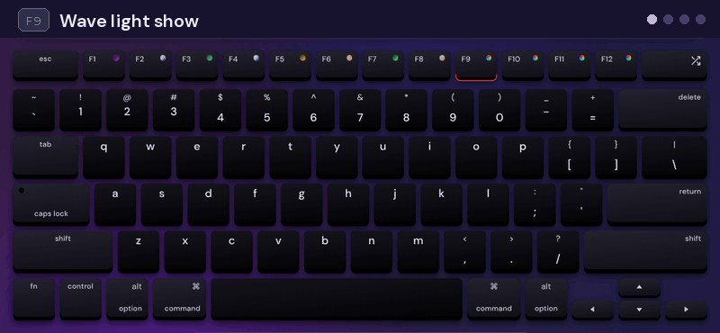
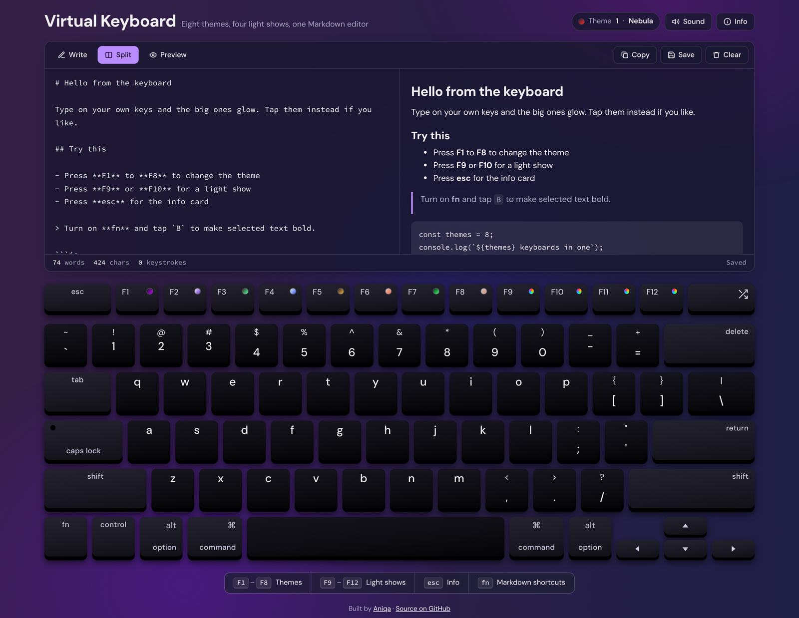
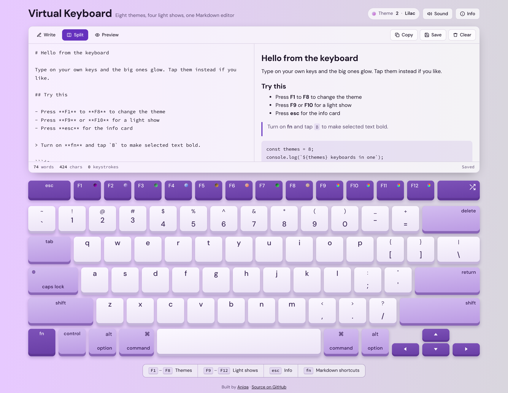
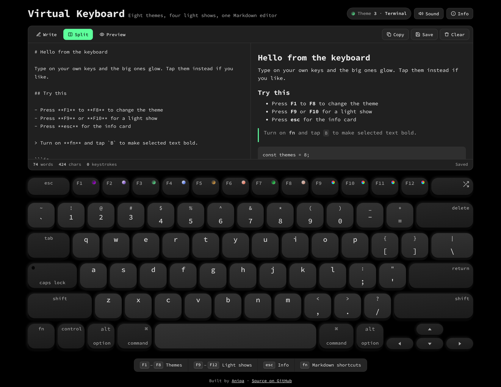
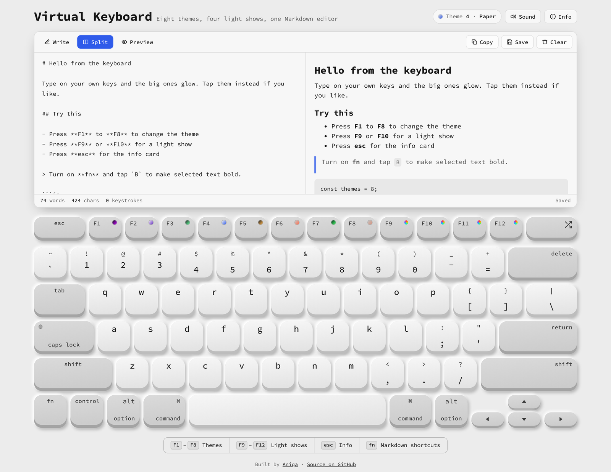
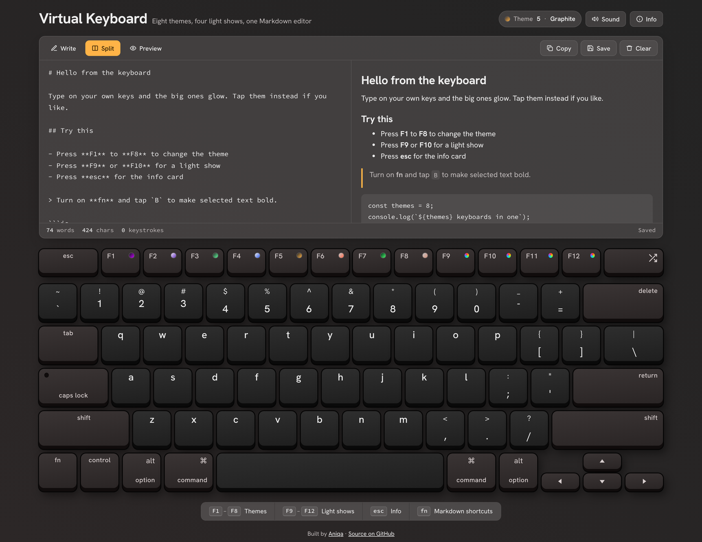
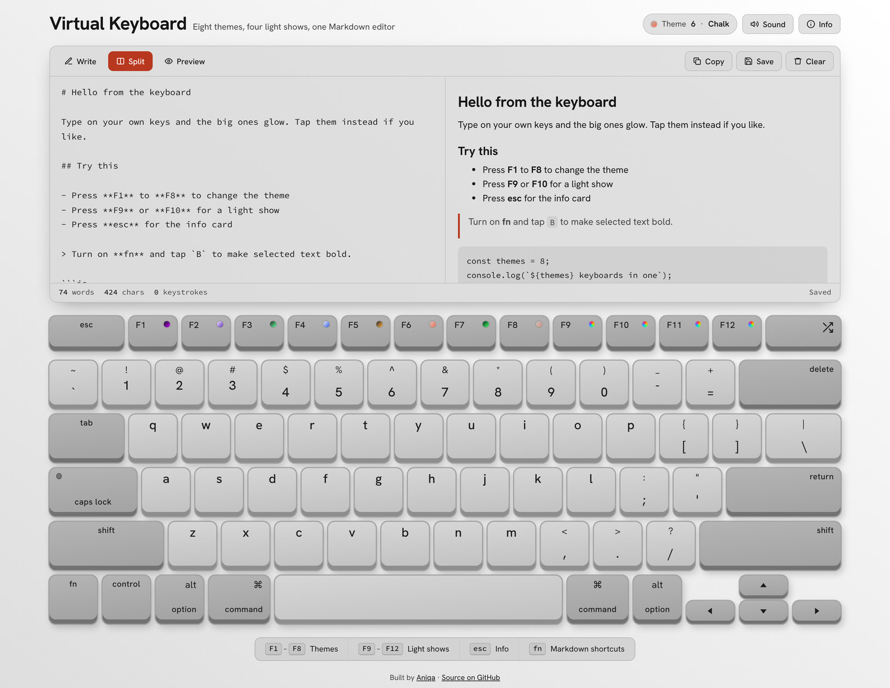
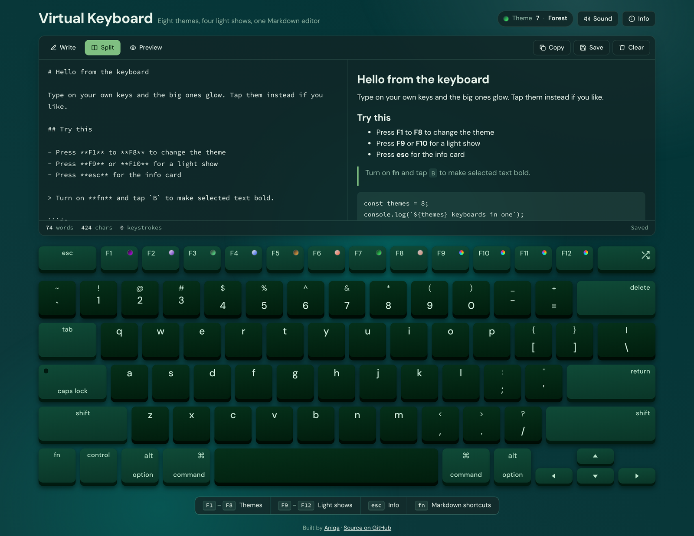
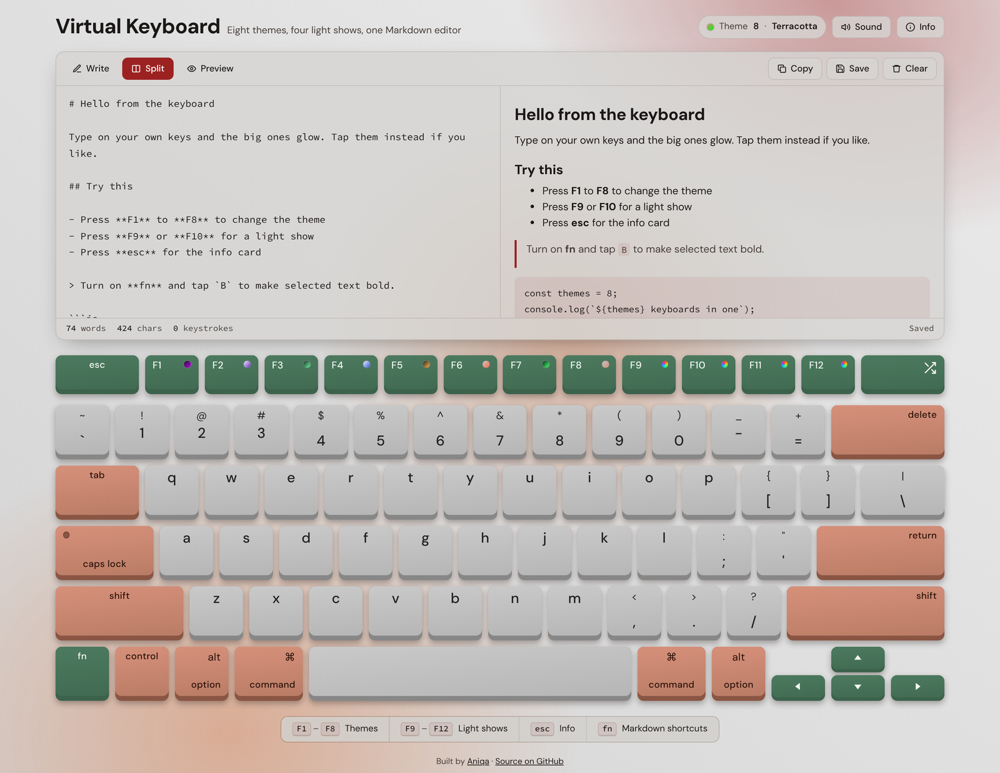
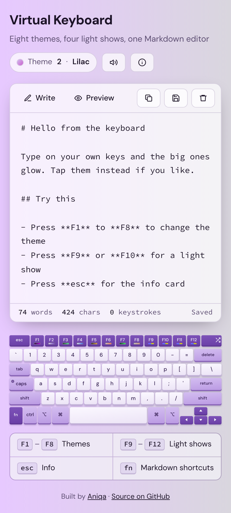

# Virtual Keyboard

A virtual keyboard with eight themes and four light shows, paired with a Markdown editor that previews as you type.

**[Live site](https://keyboard.aniqa.dev)** · [See all eight themes](#themes)

<p align="center">
	<a href="https://keyboard.aniqa.dev"></a>
</p>

## Tech

- HTML, CSS and JavaScript (ES modules, no build step)
- [Marked](https://marked.js.org/) for Markdown and [DOMPurify](https://github.com/cure53/DOMPurify) to keep the preview safe

## Features

- Responds to clicks, taps and your real keyboard in a Mac-style layout
- Eight themes (`F1`–`F8`, or the shuffle key for a random one) and four light shows (`F9`–`F12`): wave, ripple, sweep and twinkle
- A Markdown editor with Write, Split and Preview views, copy, save and clear (clear asks for a second press)
- `fn` turns on Markdown shortcuts (tap a labeled key for headings, bold, links, lists and code), plus `Ctrl`/`⌘` + `B`, `I`, `K` and list continuation
- Word, character and keystroke counts, autosave and an optional click sound
- `esc` opens an info card with every shortcut

## Design

- Each theme has its own colors, fonts, keycap style and glow; keys press down, spring back and glow in their row's color
- New themes spread out in a circle from the key you pressed (View Transitions API, where supported)
- Scales to any screen width, with short labels (`ctrl`, `⌥`, `⌘`) on small screens

## Accessibility

- WCAG AA contrast (4.5:1) in every theme, including the info card and `fn` layer
- The keyboard is one Tab stop: arrows move between keys, `Home`/`End` jump to row ends, `Enter` or `Space` presses
- Every key has a screen reader name (`F1: Nebula theme`), modifiers announce whether they're on, and shift isn't shown by color alone
- Skip link, a reachable preview and an info card that traps and returns focus
- Respects reduced motion, forced colors and increased contrast, and allows zoom

## Project structure

- `index.html`: page markup, plus a small inline script that applies the saved theme before the first paint
- `scripts/`: one module per job (`layout`, `keyboard`, `themes`, `editor`, `shows`, `modal`, `sound`, `toast`, `storage`), wired up in `main.js`
- `styles/styles.css`: themes, keyboard, editor and modal styles
- `themes/` and `assets/`: README screenshots and the click sound

## Key concepts

- **A reason to type.** The editor gives keystrokes somewhere useful to go, so the keyboard is a tool and not only a light show.
- **Keys from data.** One layout definition drives the markup, labels and shortcuts, matched to presses with `KeyboardEvent.code`.
- **Themes as CSS custom properties** on `html[data-kb]`, applied before the first paint so there's no flash of the wrong theme.
- **Native undo.** On-screen typing goes through `execCommand('insertText')`, so `Ctrl`/`⌘` + `Z` still undoes it.
- **Smooth on phones.** Light shows only animate opacity and transform (Web Animations API), and Web Audio keeps fast typing from cutting off the click.
- **Guarded storage.** `localStorage` access is wrapped, so private browsing still works.

## Setup

No build step or API keys. Serve the folder locally, since ES modules won't load from a file:

```bash
git clone https://github.com/aniqatc/keyboard.git
cd keyboard
npx serve .
# or
python3 -m http.server
```

## Changelog

### October 2026

- Redesigned the keyboard and split the code into modules
- Added the `F11` sweep and `F12` twinkle light shows, a shortcut bar and an accessibility pass

### November 2023

- Refactored into helper functions, untangling the nested animation timeouts

### January 2023

- Initial release: eight themes, `F9` and `F10` light shows, the Markdown editor with preview, click sounds and saved themes

## Themes

<table>
	<tr>
		<td width="50%"><br><sub>F1 · Nebula</sub></td>
		<td width="50%"><br><sub>F2 · Lilac</sub></td>
	</tr>
	<tr>
		<td><br><sub>F3 · Terminal</sub></td>
		<td><br><sub>F4 · Paper</sub></td>
	</tr>
	<tr>
		<td><br><sub>F5 · Graphite</sub></td>
		<td><br><sub>F6 · Chalk</sub></td>
	</tr>
	<tr>
		<td><br><sub>F7 · Forest</sub></td>
		<td><br><sub>F8 · Terracotta</sub></td>
	</tr>
</table>

<p align="center"></p>
